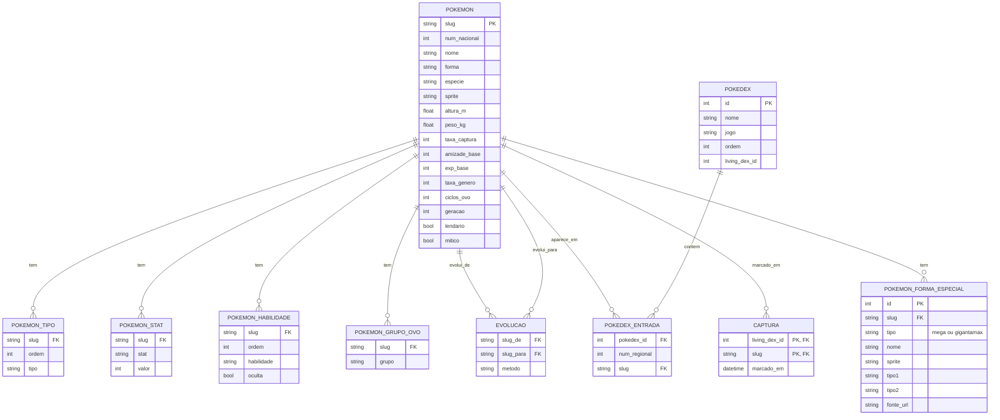

# Living Dex

Rastreador pessoal de **living dex** de Pokémon: mostra as caixas do PC exatamente como no
jogo (6 × 5 = 30 por caixa), marca quem já foi capturado e traz a ficha completa de cada
Pokémon num modal — stats, habilidades, cadeia evolutiva, defesas de tipo, Mega Evolução e
Gigantamax.


> Uma *living dex* é ter um exemplar de cada Pokémon guardado nas caixas do PC do jogo. O app
> existe pra acompanhar esse progresso sem planilha.

## Funcionalidades

- **19 living dex** — um por jogo/grupo de versão da série principal, de Red/Blue/Yellow até
  Scarlet & Violet e Legends: Z-A — mais a **Pokédex Nacional**, uma página de consulta ao
  catálogo inteiro (1085 Pokémon, incluindo formas regionais) sem caixas nem captura.
- **Marcar capturado** com um clique no botão de cada célula, ou **arrastando o mouse** por
  várias células de uma vez pra marcar/desmarcar em lote.
- **Numeração e progresso por caixa**, com check visual nas caixas já completas.
- **Busca** por nome e filtro **"só faltando"**.
- **Modal de detalhes** com dados, stats base (com faixa mín/máx no nível 100), habilidades,
  grupos de ovo, cadeia evolutiva completa (com ramos, como Applin → Appletun/Dipplin →
  Hydrapple), defesas contra os 18 tipos, formas alternativas, Mega Evolução e Gigantamax.
- **Painel de efetividade de tipo**: clicar num tipo no modal abre um painel mostrando contra
  quais tipos ele é forte e fraco, no ataque e na defesa.
- **Tema claro/escuro**, sidebar fixa (funciona bem no celular também, já que o servidor escuta
  em `0.0.0.0`).
- Progresso salvo no **banco**, não no `localStorage` — o mesmo progresso aparece no PC e no
  celular.

## Stack

Backend em **Python puro** (só biblioteca padrão — `http.server` + `sqlite3`, sem
Flask/FastAPI/venv) e frontend em **HTML/CSS/JS vanilla**, sem framework nem build step. Banco
**SQLite** com ~1085 espécies/formas e 553 evoluções.

## Como rodar

Pré-requisito: Python 3 (só biblioteca padrão, nada pra instalar com `pip`).

O repositório não traz o banco pronto nem os sprites — eles contêm dado pessoal (progresso de
captura) ou são pesados demais pra versionar, então são **gerados por script** depois de clonar.

```bash
git clone <url-do-repositorio>
cd LivingDex

# 1. cria o pokedex.db a partir do catálogo versionado em dados/catalogo.sql
#    (progresso de captura começa zerado)
python montar_banco.py

# 2. baixa os sprites (normal + shiny) do pokemondb/Bulbapedia
python baixar_sprites.py

# 3. sobe o servidor
python servidor.py
```

Depois abra `http://localhost:8000`. Pra usar outra porta:

```bash
PORTA=9000 python servidor.py
```

Os passos 1 e 2 só precisam rodar uma vez (ou de novo se apagar `pokedex.db`/`static/sprites/`
— `baixar_sprites.py` pula o que já existe, então é seguro rodar de novo a qualquer momento).

## Estrutura

```
servidor.py           servidor + API, só biblioteca padrão
montar_banco.py         cria o pokedex.db a partir de dados/catalogo.sql (1ª vez após clonar)
exportar_catalogo.py    atualiza dados/catalogo.sql a partir do pokedex.db (uso do mantenedor)
baixar_sprites.py      baixa os sprites (normal + shiny) do pokemondb
dados/catalogo.sql      dump versionado do catálogo (sem dados de captura)
pokedex.db              banco SQLite gerado localmente — não versionado (ver .gitignore)
index.html, nacional.html(+js)    páginas que ficam na raiz

static/                 CSS, JS compartilhado, fonte e sprites
  estilo.css
  livingdex.js           TIPO/CHART, montagem das caixas e o modal de detalhes
  comum.js, home.js, tema-preload.js

living-dex/              um par <jogo>.html + <jogo>.js por living dex
```

Mais detalhes de arquitetura, schema do banco e decisões de design estão em
[CONTEXTO.md](CONTEXTO.md).

## Diagrama do banco de dados



`living_dex_id` não é uma tabela própria — é só uma coluna de agrupamento em `pokedex` (várias
Pokédex do mesmo jogo compartilham o mesmo id) e a chave composta de `captura`, já que o
progresso de captura é separado por jogo, não global por Pokémon (ver `CONTEXTO.md`).

## De onde vêm os dados

Dados base dos CSVs oficiais do [PokéAPI](https://github.com/PokeAPI/pokeapi). A ordem regional
e os tipos de cada Pokédex de jogo (que não vêm nos CSVs, só o dex nacional) foram conferidos
direto nas páginas de cada jogo no [pokemondb.net](https://pokemondb.net). As listas de Mega
Evolução e Gigantamax vêm do [Bulbapedia](https://bulbapedia.bulbagarden.net).

## Projeto pessoal

Feito pra uso próprio, sem outras dependências além do Python padrão. `CONTEXTO.md` documenta
decisões e convenções do projeto com mais detalhe pra continuar o desenvolvimento depois.
